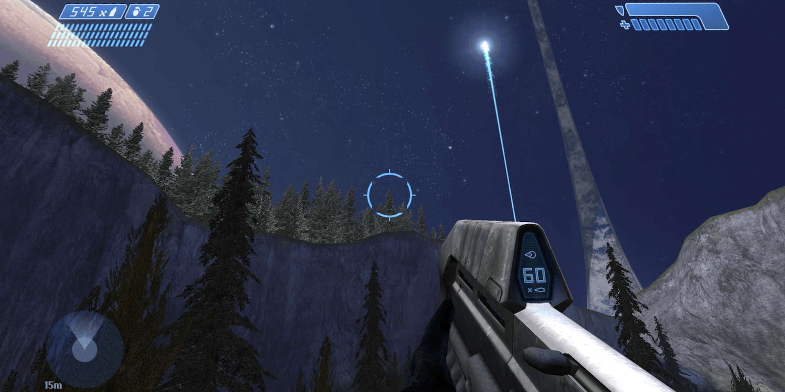
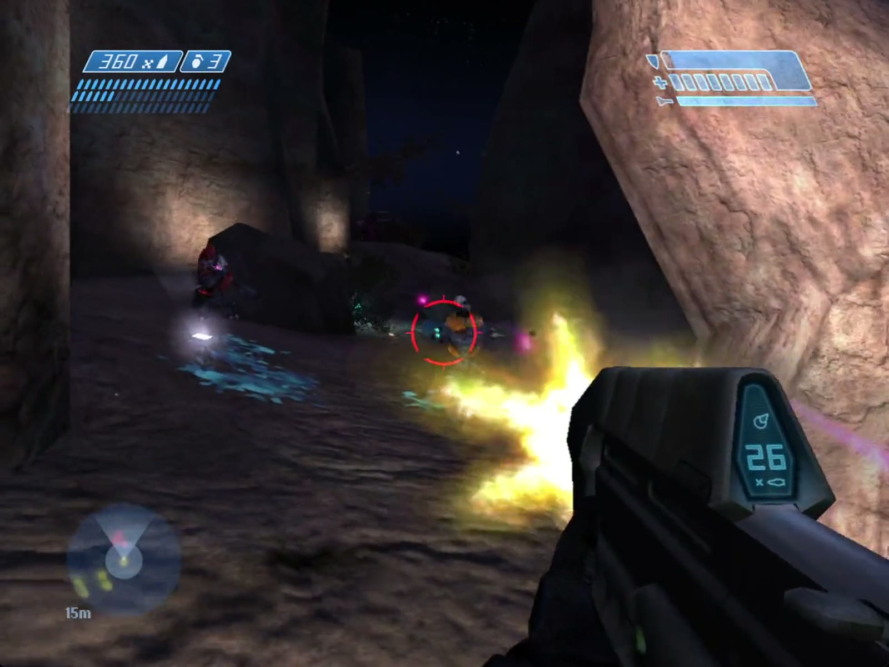

# VISR

## Experience *Halo: Combat Evolved* in a whole new dimension

{{ shared: introduction }}

{{ shared: goal }}

> "The first VISR systems date back to the early 21st century…"\
> ["Dynasty" VISR, Halo 5: Guardians](https://www.halopedia.org/Armor_customization_(Halo_5:_Guardians)/Visor)

{hero video=hero}

[Get VISR](https://github.com/steverice/visr/releases) • [Vision Pro](#apple-vision-pro) • [iPhone](#iphone) • [iPad](#ipad) • [Apple TV](#apple-tv) • [Mac](#mac) • [GitHub](https://github.com/steverice/visr)

## Behind the visor like never before

{{ look-around }}

## A premium experience on every device

{{ shared: every-device }}

## Apple Vision Pro

{{ features: vision-pro }}

{device=vision video=vision}

## iPhone

{{ features: iphone }}

{device=iphone video=iphone}

## iPad

{{ features: ipad }}

{device=ipad video=ipad}

## Apple TV

{{ features: apple-tv }}

{device=tv video=tv}

## Mac

{{ features: mac }}

{device=mac video=mac}
